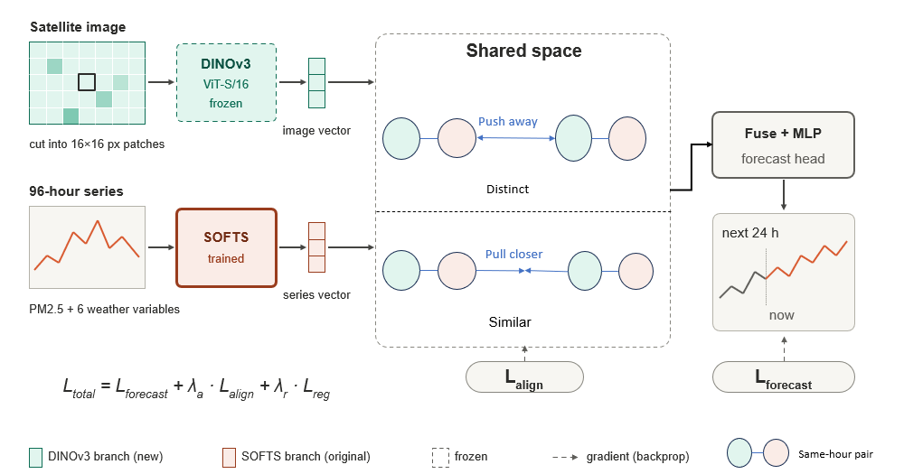

# DINOv3 + SOFTS for Hourly PM2.5 Forecasting (Hanoi)

An experimental project extending the [SOFTS framework](https://github.com/Secilia-Cxy/SOFTS) with a DINOv3 visual feature extraction branch to explore multimodal hourly PM2.5 forecasting in Hanoi.

The model uses 96 hours of air-quality and weather data, optionally combined with satellite imagery, to predict PM2.5 concentrations for the next 24 hours.

- **Live Demo:** [Streamlit App](https://timeserieappfts-gpfkmqdj9hil3agwv7dsne.streamlit.app/)
- **Dataset:** [Kaggle Dataset](https://www.kaggle.com/datasets/dtoaneasy/hanoi-pm2-5-and-weather-hourly-dataset)
- **Version:** `v0.1` (Experimental)
- **Last Updated:** 2026-10-24

---

## Table of contents

1. [Project Overview](#1-project-overview)
2. [System Overview: where DINOv3 is updated](#2-system-overview-where-dinov3-is-updated)
3. [Environment](#3-environment)
4. [Setup](#4-setup)
5. [Run & Verify](#5-run--verify)
6. [Usage](#6-usage)
7. [AI Model](#7-ai-model)
8. [Loss Function](#8-loss-function)
9. [Training and Evaluation](#9-training-and-evaluation)
10. [Troubleshooting](#10-troubleshooting)
11. [Limitations](#11-limitations)
12. [Project Structure](#12-project-structure)
13. [References and Acknowledgement](#13-references-and-acknowledgement)

---

## 1. Project Overview

**Problem.** Fine particulate matter (PM2.5) changes hour by hour with weather and local emissions. Short-term forecasts help people and authorities plan outdoor activity and respond to polluted periods.

**Task.**

| | Shape | Description |
|---|---|---|
| Input | `X ∈ ℝ^(96×7)` | 96 consecutive hourly observations of 7 variables |
| Output | `Y ∈ ℝ^(24×1)` | PM2.5 for the next 24 hourly steps |

The 7 input variables:

| Variable | Description |
|---|---|
| `pm25` | PM2.5 concentration (µg/m³), also the prediction target |
| `pm10` | PM10 concentration |
| `temperature` | Air temperature |
| `humidity` | Relative humidity |
| `wind_speed` | Wind speed |
| `pressure` | Atmospheric pressure |
| `rainfall` | Rainfall |

**Scope of this version**

- SOFTS baseline for PM2.5 forecasting (trained checkpoint available).
- DINOv3 image branch fused with SOFTS through a projection and alignment module and an extra alignment loss.
- Streamlit demo application.

**Out of scope:** real-time data ingestion, per-district models, health advice.

---

## 2. System Overview: where DINOv3 is updated



*Figure: Overall architecture of the proposed multi-modal forecasting framework combining DINOv3 and SOFTS.*


### What was changed compared with baseline SOFTS

| Component | Baseline SOFTS | This project (DINOv3 update) | Trainable? |
|---|---|---|---|
| Input | Time series `(B, 96, 7)` | Time series `(B, 96, 7)` **+ satellite image** `(B, 3, H, W)`, e.g. 224×224 | n/a |
| Image encoder | none | **DINOv3 ViT-S/16**, produces spatial features `F_img` `(B, D_s)` | Frozen, or fine-tuned in part |
| Temporal encoder | SOFTS | SOFTS, same role, produces temporal features `F_ts` `(B, D_t)` | Yes |
| Projection and alignment | none | **New.** `P_img` and `P_ts` map both features to a shared space `(B, D)` | Yes |
| Fusion | none | **New.** Combines `z` and `u` into one fused feature `F` | Yes |
| Forecast head | SOFTS output layer | MLP forecasting head, output `(B, 24, 1)` | Yes |
| Loss | MSE on forecast | **`L_total = L_forecast + λ_a·L_align + λ_r·L_reg`** (see [Section 8](#8-loss-function)) | n/a |

> **TODO (maintainers):** state the exact class and function names in `models/DINOv3_PM25.py` for each row above, and the exact fusion operation (for example concatenation). The figure only says "mapping + fusion".

> **Current deployment status:** the Streamlit app (`softs_pm25_deploy/app.py`) loads `models/SOFTS.py` only, so the live demo shows the **SOFTS** forecast. The DINOv3 variant is an experimental branch and is not used by the demo.

---

## 3. Environment

| Item | Requirement | Note |
|---|---|---|
| OS | <!-- TODO: e.g. Windows 11 / Ubuntu 22.04 --> | State the OS you actually tested |
| Python | 3.9 or newer (the app uses `zoneinfo`) | <!-- TODO: exact tested version, e.g. 3.10.x --> |
| Packages | `torch`, `numpy`, `pandas`, `matplotlib`, `streamlit` | Pin versions in `requirements.txt` <!-- TODO: add file and versions --> |
| Hardware | CPU is enough for the demo. GPU is used automatically if CUDA is available | <!-- TODO: RAM needed --> |
| AI model file | see below | Checkpoint is not in the repository root; put it at the exact path below |
| Internet | Not needed to run the demo locally | Needed only to download DINOv3 weights for the DINOv3 variant |

**Files the app requires** (the app searches upward from `app.py` until it finds all three):

```text
models/SOFTS.py
data/scaler_stats.csv
data/windows_96_to_24.npz
checkpoints/long_term_forecast_Hanoi_PM25_SOFTS_PM25_ftMS_sl96_ll48_pl24_dm128_el2_dl1_df256_fc1_ebtimeF_dtTrue_test/checkpoint.pth
```

- `scaler_stats.csv` needs the columns `feature`, `mean`, and `scale` (or `std`), with a row for each of the 7 variables.
- `windows_96_to_24.npz` needs `X_test` with shape `(N, 96, 7)`. `Y_test` is optional; when present the app shows MAE and MSE.

**Configuration:** the app needs no `.env` file and no API keys. All settings are constants at the top of `softs_pm25_deploy/app.py`.

**DINOv3 variant only:** download the pretrained DINOv3 weights from the [official page](https://ai.meta.com/resources/models-and-libraries/dinov3-downloads/) and the code from the [official repository](https://github.com/facebookresearch/dinov3). <!-- TODO: state where the weight file must be placed. -->

---

## 4. Setup

Run all commands from the repository root.

**Step 1. Clone the repository**

```bash
git clone <your-repository-url>
cd <repository-folder>
```

**Step 2. Create and activate a virtual environment**

```bash
python -m venv .venv
.venv\Scripts\activate        # Windows
source .venv/bin/activate     # macOS / Linux
```

Expected: the prompt starts with `(.venv)`.

**Step 3. Install dependencies**

```bash
pip install -r requirements.txt
```

Expected: ends with `Successfully installed ...`. Check with `python -c "import torch, streamlit; print(torch.__version__, streamlit.__version__)"`.

**Step 4. Place the model and data files**

Put the files listed in [Section 3](#3-environment) at exactly those paths.

Expected check (prints `True` four times):

```bash
python -c "from pathlib import Path; [print(Path(p).exists()) for p in ['models/SOFTS.py','data/scaler_stats.csv','data/windows_96_to_24.npz','checkpoints/long_term_forecast_Hanoi_PM25_SOFTS_PM25_ftMS_sl96_ll48_pl24_dm128_el2_dl1_df256_fc1_ebtimeF_dtTrue_test/checkpoint.pth']]"
```

**Step 5 (recommended). Force the light theme**

Create `.streamlit/config.toml` in the repository root so the interface stays readable when the browser or OS uses dark mode:

```toml
[theme]
base = "light"
primaryColor = "#1d4ed8"
backgroundColor = "#f4f7fc"
secondaryBackgroundColor = "#ffffff"
textColor = "#17233c"
```

---

## 5. Run & Verify

```bash
streamlit run softs_pm25_deploy/app.py
```

Expected output in the terminal:

```text
You can now view your Streamlit app in your browser.
Local URL: http://localhost:8501
```

**How to verify it works**

1. Open `http://localhost:8501`. The title **Hanoi Air Intelligence** appears with three tabs: *Forecast Chart*, *24-Hour Forecast*, *Data Table*.
2. Click **Run Forecast** in the left panel.
3. The chart shows a blue historical line (96 h) and an orange forecast line (24 h). The *24-Hour Forecast* tab shows 24 cards and the *Data Table* tab shows 24 rows.
4. Click **Download Forecast CSV**. The file `hanoi_pm25_forecast_24h.csv` has the columns `Date`, `Time`, `Predicted PM2.5 (µg/m³)` and 24 rows.

<!-- TODO: add a screenshot, e.g.  -->

---

## 6. Usage

| Action | How |
|---|---|
| Choose a language | Selector at the top right (English / Tiếng Việt) |
| Run a forecast | **Run Forecast**. Each click picks a different random test window |
| Read the result | *Forecast Chart*: peak value and time, average, and hours above the 50 µg/m³ reference line |
| See hourly values | *24-Hour Forecast* tab (colour-coded) and *Data Table* tab |
| Export | **Download Forecast CSV** and **Download Chart PNG** |

**Concentration categories used for the colour coding:** Good ≤ 12, Moderate 12–35, High 35–55, Poor > 55 µg/m³. The dashed 50 µg/m³ line is a display reference level.

The project has no REST API.

---

## 7. AI Model

| Item | Baseline SOFTS (deployed) | DINOv3 + SOFTS (experimental) |
|---|---|---|
| Source file | `models/SOFTS.py` | `models/DINOv3_PM25.py` |
| Task | Multivariate time-series regression, PM2.5, 24 steps ahead | Same, with an added image branch |
| Input | `(B, 96, 7)`, standardised with `scaler_stats.csv` | `(B, 96, 7)` and satellite image `(B, 3, H, W)` |
| Output | `(B, 24, 1)`, converted back to µg/m³ and clipped at 0 | `(B, 24, 1)` |
| Checkpoint | `checkpoints/long_term_forecast_Hanoi_PM25_SOFTS_PM25_ftMS_sl96_ll48_pl24_dm128_el2_dl1_df256_fc1_ebtimeF_dtTrue_test/checkpoint.pth` | <!-- TODO: checkpoint path --> |

**SOFTS configuration used by the app**

| Parameter | Value |
|---|---|
| `seq_len` / `label_len` / `pred_len` | 96 / 48 / 24 |
| `enc_in` / `dec_in` / `c_out` | 7 / 1 / 1 |
| `d_model` / `d_core` | 128 / 128 |
| `e_layers` / `d_layers` | 2 / 1 |
| `d_ff` / `dropout` | 256 / 0.1 |
| `use_norm` | true |

**Confidence and thresholds:** the model returns point forecasts only, with no confidence score. The 50 µg/m³ line is a reference level for display, not a model decision threshold.

---


## 8. Loss Function

The DINOv3 variant uses a combined objective consisting of the forecasting loss, alignment loss, and optional regularization.

The total loss is defined as:

$$
\mathcal{L}_{\mathrm{total}} =
\mathcal{L}_{\mathrm{forecast}} +
\lambda_a \mathcal{L}_{\mathrm{align}} +
\lambda_r \mathcal{L}_{\mathrm{reg}}
$$

| Term | Purpose |
|---|---|
| `L_forecast` | Error between predicted and observed PM2.5 |
| `L_align` | Aligns image and time-series representations |
| `L_reg` | Optional regularization term |
| `lambda_a`, `lambda_r` | Weights controlling each loss term |

**Forecast loss (MSE).** Here, B is the batch size and T = 24 is the forecast horizon.

$$
\mathcal{L}_{\mathrm{forecast}} =
\frac{1}{BT}
\sum_{b=1}^{B}
\sum_{t=1}^{T}
\left(y_{b,t}-\hat{y}_{b,t}\right)^2
$$

Huber loss may be used instead of MSE when outliers have a substantial effect.

### Alignment Loss (InfoNCE)

For each sample i, let z_i and u_i be the L2-normalised projections of the image feature and the time-series feature, respectively. Their cosine similarity is denoted by s_ij.

The alignment loss is:

$$
\mathcal{L}_{\mathrm{align}} =
-\frac{1}{B}
\sum_{i=1}^{B}
\log
\left(
\frac{\exp(s_{ii}/\tau)}
{\sum_{j=1}^{B}\exp(s_{ij}/\tau)}
\right)
$$

Here, B is the batch size and tau is the temperature parameter. Matching pairs are pulled together, while non-matching pairs are pushed apart.

### Loss Configuration

The following values must match the actual training code:

- `lambda_a`: To be confirmed
- `lambda_r`: To be confirmed
- `tau`: To be confirmed
- `Lreg`: Specify the regularizer used, or state `disabled` if regularization is not applied.

The loss equations and parameter values must match the implementation used during training.

---

## 9. Training and Evaluation


**Reproducibility checklist**

- [ ] DINOv3 backbone and pretrained weights load without error.
- [ ] Tensor shapes match: `(B, 96, 7)` in, `(B, 24, 1)` out.
- [ ] The combined loss is the one applied during training.
- [ ] Train, validation and test windows are separate, and test data is not used for fitting or scaler statistics.
- [ ] The SOFTS baseline and the DINOv3 variant use the same split, horizon and metrics.

**Training command for the SOFTS baseline.** Reconstructed from the checkpoint folder name (`model_id=Hanoi_PM25`, `data=PM25`, `features=MS`); verify the data flags against your `data_provider` before running:

```bash
python run.py --task_name long_term_forecast --is_training 1 \
  --root_path ./data/ --data_path <TODO: your csv file> \
  --model_id Hanoi_PM25 --model SOFTS --data PM25 --features MS --target pm25 \
  --seq_len 96 --label_len 48 --pred_len 24 \
  --enc_in 7 --dec_in 1 --c_out 1 \
  --e_layers 2 --d_layers 1 --d_model 128 --d_ff 256 --factor 1 --des test
```

<!-- TODO: add the training command for the DINOv3 variant. -->

**Metrics**

$$
\mathrm{MAE} = \frac{1}{N}\sum_{i=1}^{N}\left|y_i-\hat{y}_i\right|, \qquad
\mathrm{MSE} = \frac{1}{N}\sum_{i=1}^{N}\left(y_i-\hat{y}_i\right)^2, \qquad
\mathrm{RMSE} = \sqrt{\mathrm{MSE}}
$$

The app reports MAE and MSE for the displayed sample when `Y_test` exists in the `.npz` file.

**Results** (same split, 24-hour horizon)

| Model | MAE (µg/m³) | RMSE (µg/m³) | Notes |
|---|---|---|---|
| SOFTS baseline | <!-- TODO --> | <!-- TODO --> | |
| DINOv3 + SOFTS | <!-- TODO --> | <!-- TODO --> | |

> Report only numbers measured on the held-out test set. Do not copy the per-sample MAE/MSE shown in the app as model accuracy.

---

## 10. Troubleshooting

| Message or symptom | Likely cause | Fix |
|---|---|---|
| `ModuleNotFoundError` | Requirements not installed or the virtual environment is not active | Activate `.venv`, then `pip install -r requirements.txt` |
| `Could not find project files: models/SOFTS.py, data/scaler_stats.csv, data/windows_96_to_24.npz` | A required file is missing or in the wrong folder | Check the tree in [Section 12](#12-project-structure); the two data files must be directly inside `data/` |
| `Missing checkpoint: ...` | Checkpoint folder name or location is wrong | Use the exact path in [Section 3](#3-environment), including the long folder name |
| `Error(s) in loading state_dict` | The checkpoint was trained with a different model configuration | Keep `MODEL_CONFIG` in `app.py` identical to the training settings in [Section 7](#7-ai-model) |
| `X_test must have shape (N, 96, 7)` | Wrong array in the `.npz` file | Rebuild the windows as 96 hours × 7 variables |
| `Missing scaler values for: ...` | `scaler_stats.csv` lacks a variable | Add rows for all 7 variables with `mean` and `scale` |
| Tab labels are hard to read | Dark OS theme combined with the custom CSS | Create `.streamlit/config.toml` ([Setup, Step 5](#4-setup)), reboot the app, and hard-refresh the page (Ctrl+F5) |
| Port 8501 already in use | Another Streamlit instance is running | `streamlit run softs_pm25_deploy/app.py --server.port 8502` |

---

## 11. Limitations

- **The demo is a replay, not live forecasting.** *Run Forecast* picks a random 96-hour window from the stored test set (`X_test`) and predicts the 24 hours after it. The time axis is labelled relative to the current clock time, but the values are not today's measurements.
- **The area selector does not change the model.** All areas use the same city-wide model and data.
- **"Predict Rate" is a display indicator**, not a measured accuracy.
- **Before the first click** the chart shows a flat placeholder line (mean of the last 24 historical hours), and MAE/MSE are computed against that placeholder, not against the model.
- **DINOv3 is a vision model.** Using it for forecasting needs a suitable image source and does not guarantee better accuracy than SOFTS. Compare against the baseline under identical conditions ([Section 9](#9-training-and-evaluation)).
- The deployed app uses the SOFTS baseline only.

---

## 12. Project Structure

```text
SOFTS/
├── models/
│   ├── SOFTS.py                 # SOFTS model (used by the app)
│   └── DINOv3_PM25.py           # DINOv3 + SOFTS variant (experimental)
├── data/
│   ├── scaler_stats.csv         # mean/scale of the 7 variables (required by the app)
│   └── windows_96_to_24.npz     # X_test (N,96,7) and optional Y_test (required by the app)
├── softs_pm25_deploy/
│   └── app.py                   # Streamlit application
├── checkpoints/
│   └── long_term_forecast_..._test/checkpoint.pth
├── imgs/
│   └── dinov3_softs_architecture.png
├── .streamlit/
│   └── config.toml              # forces the light theme
└── README.md
```

- Keep private or restricted raw data outside the public repository. If you separate `data/public/` and `data/private/`, the two files required by the app must still be reachable at `data/scaler_stats.csv` and `data/windows_96_to_24.npz`.
- Private raw data and intermediate files should not be committed unless they are meant for distribution.

**Data preparation pipeline:** load hourly air-quality and weather records → align by hourly timestamp → handle missing values → detect and handle outliers with explicit criteria → build 96-hour input windows and 24-hour targets → standardise with `scaler_stats.csv` → split into train, validation and test. <!-- TODO: state the collection period, missing-value rule and outlier rule actually used. -->

---

## 13. References and Acknowledgement

- Han, L., Chen, X.-Y., Ye, H.-J., Zhan, D.-C. *SOFTS: Efficient Multivariate Time Series Forecasting with Series-Core Fusion.* NeurIPS 2024. [Paper](https://arxiv.org/pdf/2404.14197.pdf) · [Code](https://github.com/Secilia-Cxy/SOFTS)
- DINOv3 official repository: https://github.com/facebookresearch/dinov3
- DINOv3 pretrained weights: https://ai.meta.com/resources/models-and-libraries/dinov3-downloads/
- Kaggle dataset: https://www.kaggle.com/datasets/dtoaneasy/hanoi-pm2-5-and-weather-hourly-dataset

```bibtex
@article{han2024softs,
  title={SOFTS: Efficient Multivariate Time Series Forecasting with Series-Core Fusion},
  author={Han, Lu and Chen, Xu-Yang and Ye, Han-Jia and Zhan, De-Chuan},
  journal={arXiv preprint arXiv:2404.14197},
  year={2024}
}
```

The SOFTS code base builds on [Informer2020](https://github.com/zhouhaoyi/Informer2020), [Autoformer](https://github.com/thuml/Autoformer), [Time-Series-Library](https://github.com/thuml/Time-Series-Library) and [iTransformer](https://github.com/thuml/iTransformer).

<details>
<summary>Original upstream SOFTS instructions (kept for reference)</summary>

- Upstream prerequisites: `scikit-learn==1.2.2`, `numpy==1.22.4`, `pandas==1.2.4`, `torch==1.10.0+cu111`.
- Datasets: download from [Google Drive](https://drive.google.com/drive/folders/1QPM7MMKlzVffdzbGGkzARDuIqiYRed_f?usp=drive_link) or [NJU Box](https://box.nju.edu.cn/d/abc2bbd7cff6461eb4da/) and place them under `dataset/`.
- Own dataset: add a dataset class in `data_provider/data_loader.py` (see `Dataset_Custom`), register it in `data_dict` in `data_provider/data_factory.py`, then pass `--data`, `--root_path`, `--data_path` to the scripts. An alternative API is in `exp/exp_custom.py` and `run_on_your_own_dataset.ipynb`.
- Reproduce paper results: `sh scripts/long_term_forecast/ETT_script/SOFTS_ETTm1.sh`.

</details>