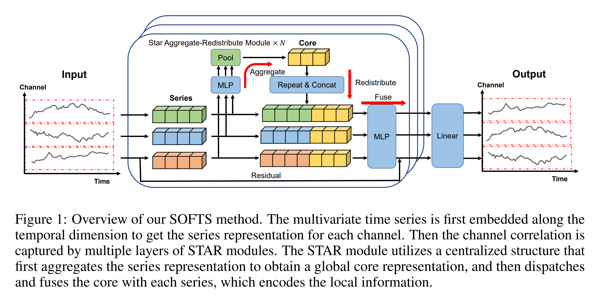
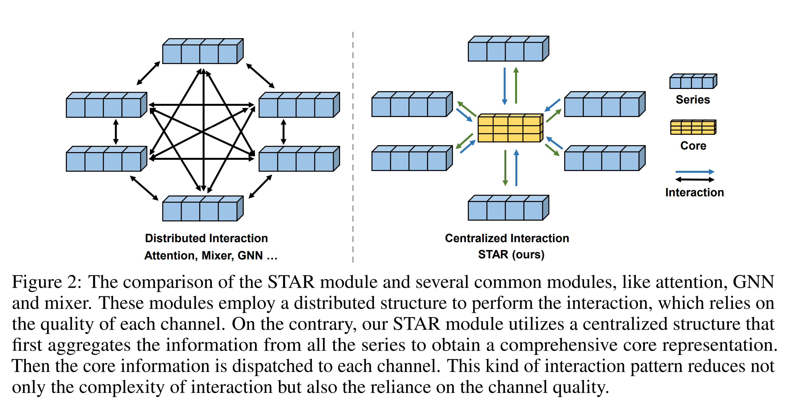
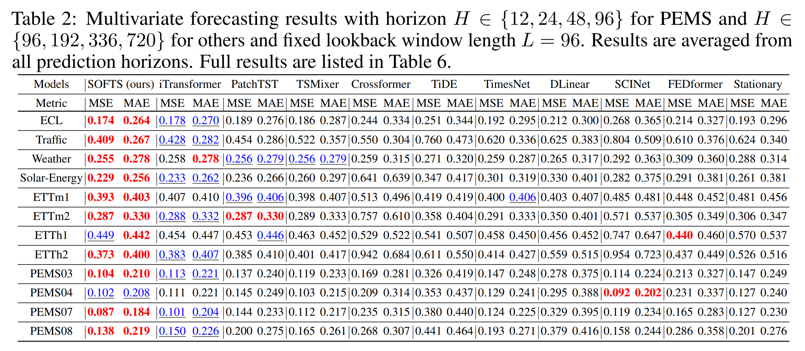
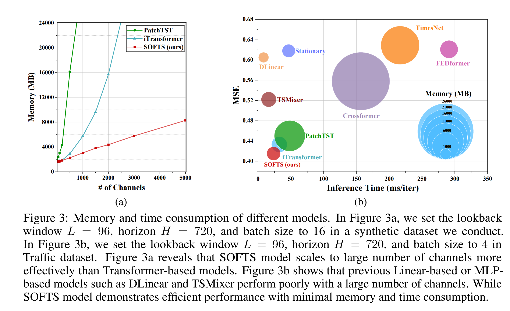

# (NeurIPS 2024) SOFTS: Efficient Multivariate Time Series Forecasting with Series-Core Fusion

The code repository for [SOFTS: Efficient Multivariate Time Series Forecasting with Series-Core Fusion](https://arxiv.org/pdf/2404.14197.pdf) in PyTorch. A scalable pure MLP model that achieves state-of-the-art performance on multivariate time series forecasting benchmarks. 

[[中文介绍]](https://mp.weixin.qq.com/s/KRolsx7OVYV-JS-MatpH1Q) [[Medium]](https://towardsdatascience.com/softs-the-latest-innovation-in-time-series-forecasting-dbc82553dd76)
[[TowardsAI]](https://towardsai.net/p/l/softs-efficient-multivariate-time-series-forecasting-with-series-core-fusion)

🚩 2024.9.26 Our paper has been accepted to NeurIPS 2024 as a poster presentation!

### Main Structure



#### Star Aggregate-Redistribute Module (STAR)



#### Performance Comparison



#### Efficiency Comparison



## Prerequisites

scikit-learn==1.2.2

numpy==1.22.4

pandas==1.2.4

torch==1.10.0+cu111

## Datasets

You can directly download the datasets used in the paper from [Google Drive](https://drive.google.com/drive/folders/1QPM7MMKlzVffdzbGGkzARDuIqiYRed_f?usp=drive_link) or [NJU Box](https://box.nju.edu.cn/d/abc2bbd7cff6461eb4da/). 

Once downloaded, place the datasets under folder `dataset/`, like `dataset/ETT-small`, `dataset/traffic`, etc.

## Run on your own dataset

### Choice 1: Use scripts to run
If you wish to utilize your own datasets, please follow these steps:

1. **Dataset Format**: Make sure your datasets follow the format of the provided datasets. Typically, the first column should contain dates, and the remaining columns should represent variables to predict. This consistency will help seamlessly integrate your datasets into the existing infrastructure.

2. **Dataset Class Creation**: Create a dataset class within `data_provider/data_loader.py`. Refer to the structure of the `Dataset_Custom` class for guidance. This class should handle the loading and preprocessing of your dataset.

3. **Update Data Dictionary**: Update the `data_dict` in `data_provider/data_factory.py` to include your dataset. 

4. **Usage in Scripts**: Utilize your dataset within the scripts by specifying the appropriate parameters. 
   - The `--data` parameter should match the dataset key within the `data_dict`.
   - The `--root_path` parameter should point to the folder containing your dataset.
   - The `--data_path` parameter should specify the file name of your dataset.

Refer to the examples in `scripts/long_term_forecast` for guidance on how to integrate your custom dataset into the existing scripts.

### Choice 2: Use the provided API
We have provided a custom exp class in `exp/exp_custom.py` and a guidance Jupyter notebook `run_on_your_own_dataset.ipynb` to help you run the model on your own dataset.

## Scripts

To reproduce the main results in Table 2, run the script files under folder `scripts/long_term_forecast`.

For example, to reproduce the results of SOFTS on ETTm1 dataset, run the following command:

```sh scripts/long_term_forecast/ETT_script/SOFTS_ETTm1.sh```

## Acknowledgement

We appreciate the following github repos a lot for their valuable code base or datasets:

https://github.com/zhouhaoyi/Informer2020

https://github.com/thuml/Autoformer

https://github.com/zhouhaoyi/ETDataset

https://github.com/laiguokun/multivariate-time-series-data

https://github.com/thuml/Time-Series-Library

https://github.com/thuml/iTransformer

## Reference

If you find our work useful in your research, please use the following citation:

```
@article{han2024softs,
  title={SOFTS: Efficient Multivariate Time Series Forecasting with Series-Core Fusion},
  author={Han, Lu and Chen, Xu-Yang and Ye, Han-Jia and Zhan, De-Chuan},
  journal={arXiv preprint arXiv:2404.14197},
  year={2024}

}
```
DINOv3 Integration for PM2.5 Forecasting

This project extends the SOFTS time-series forecasting framework with an experimental DINOv3 backbone integration for hourly PM2.5 forecasting.

The objective is to investigate the combination of DINOv3 feature extraction and SOFTS temporal modeling for air-quality forecasting.

SOFTS repository: https://github.com/Secilia-Cxy/SOFTS

Official DINOv3 repository: https://github.com/facebookresearch/dinov3

DINOv3 pretrained weights: https://ai.meta.com/resources/models-and-libraries/dinov3-downloads/

Live Demo

Streamlit application: https://timeserieappfts-gpfkmqdj9hil3agwv7dsne.streamlit.app/

The deployed application can be accessed through a web browser.

1. Forecasting Task

The model uses 96 hours of historical air-quality and meteorological observations to predict PM2.5 concentrations for the following 24 hours.

Input tensor:

$$
X \in \mathbb{R}^{96 \times 7}
$$

Prediction target:

$$
Y \in \mathbb{R}^{24 \times 1}
$$

The seven input variables are:
| Variable | Description |
|---|---|
| `pm25` | PM2.5 concentration |
| `pm10` | PM10 concentration |
| `temperature` | Air temperature |
| `humidity` | Relative humidity |
| `wind_speed` | Wind speed |
| `pressure` | Atmospheric pressure |
| `rainfall` | Rainfall |

The model predicts only PM2.5 concentrations for the next 24 hourly time steps.


The model predicts only PM2.5 concentrations for the next 24 hourly time steps.

2. DINOv3 Backbone Integration

DINOv3 is a vision foundation model designed to learn visual representations from images. In this experimental approach, historical time-series data must be transformed into an appropriate image-like representation before being processed by the DINOv3 backbone.

The extracted representations can then be integrated into the forecasting architecture. SOFTS is used for temporal modeling and future prediction according to the implemented model design.

Implementation note: The actual feature transformation and connection between DINOv3 and SOFTS must match the model code. The integration should be validated through tensor-shape checks, training, and evaluation.

3. Updated Loss Function

The loss function measures the difference between predicted and actual PM2.5 concentrations. The training objective must match the loss implemented in the training code.

For reference, the standard Mean Squared Error (MSE) objective for a batch of 24-step forecasts is:

$$
\mathcal{L}_{\mathrm{MSE}}
=
\frac{1}{24B}
\sum_{b=1}^{B}
\sum_{t=1}^{24}
\left(y_{b,t}-\hat{y}_{b,t}\right)^2
$$

where:

- \(B\) is the batch size.
- \(y_{b,t}\) is the actual PM2.5 concentration for sample \(b\) at forecast step \(t\).
- \(\hat{y}_{b,t}\) is the predicted PM2.5 concentration.

This equation is provided as a standard MSE reference. It must be replaced with the actual updated loss equation if the implementation uses a different loss function or a combination of losses.

4. Kaggle Dataset

Public Kaggle dataset: https://www.kaggle.com/datasets/dtoaneasy/hanoi-pm2-5-and-weather-hourly-dataset

The dataset documentation should identify the data source, collection period, variables, measurement units, and preprocessing procedures.

The data preparation pipeline includes:

Loading or collecting air-quality and meteorological observations.

Aligning records using hourly timestamps.

Handling missing values according to the preprocessing configuration.

Detecting and handling outliers using explicit criteria.

Constructing historical input windows and future prediction targets.

Preparing processed data for model training, evaluation, and inference.

The forecasting samples follow this structure:

$$
X_b \in \mathbb{R}^{96 \times 7}
$$

$$
Y_b \in \mathbb{R}^{24 \times 1}
$$

Each input window contains 96 consecutive hourly observations, while the target contains the next 24 hourly PM2.5 values.

Private raw data and intermediate files should remain outside the public release unless they are explicitly intended for distribution.

5. Streamlit PM2.5 Forecasting Application

The project provides a Streamlit application for demonstrating PM2.5 forecasting.

Live application: https://timeserieappfts-gpfkmqdj9hil3agwv7dsne.streamlit.app/

To run the application locally from the repository root:

streamlit run softs_pm25_deploy/app.py

This command assumes that the application file exists at the specified path and that the required dependencies are installed.

Predictions displayed by the application should be generated through model inference using the trained model and its associated preprocessing pipeline.

6. Training and Evaluation

Training and evaluation commands depend on the scripts available in the repository. Verify the actual filenames before running the experiments.

The experimental workflow should verify that:

The DINOv3 backbone and pretrained weights are loaded correctly.

The DINOv3 feature extractor is connected to the forecasting model.

Input and output dimensions match the forecasting configuration.

The updated loss function is applied during training.

Training, validation, and test data are separated appropriately.

Evaluation uses data not used for model fitting.

Recommended regression metrics include Mean Absolute Error (MAE) and Root Mean Squared Error (RMSE).

**Mean Absolute Error (MAE):**

$$
\mathrm{MAE}
=
\frac{1}{N}
\sum_{i=1}^{N}
\left|y_i-\hat{y}_i\right|
$$

**Root Mean Squared Error (RMSE):**

$$
\mathrm{RMSE}
=
\sqrt{
\frac{1}{N}
\sum_{i=1}^{N}
\left(y_i-\hat{y}_i\right)^2
}
$$

Lower MAE and RMSE values indicate smaller prediction errors on the evaluated dataset.

7. Reproducibility and Limitations

DINOv3 is primarily designed for visual representation learning. Applying it to time-series forecasting requires an appropriate representation strategy and does not automatically guarantee better forecasting performance.

The experimental results should be compared with a suitable SOFTS baseline using the same data splits, forecasting horizon, and evaluation metrics.

For reproducibility, document the dataset version, preprocessing configuration, model checkpoint, training parameters, loss function, and evaluation results.

8. References

SOFTS: Efficient Multivariate Time Series Forecasting with Series-Core Fusion. https://github.com/Secilia-Cxy/SOFTS

DINOv3 official repository. https://github.com/facebookresearch/dinov3

DINOv3 pretrained model access. https://ai.meta.com/resources/models-and-libraries/dinov3-downloads/
